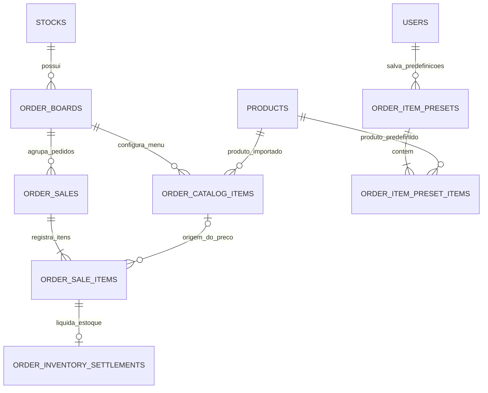

# Domínio de pedidos e Kanban

Cada Kanban pertence a um estoque. Ele possui um menu importado com preços próprios e concentra os pedidos de uma operação, dia ou equipe.

As tabelas físicas preservam os nomes usados pelas RPCs existentes. Para leituras novas, prefira estas views:

| View | Uso |
|---|---|
| `order_board_menu_items` | Produtos importados e preço configurado em cada Kanban. |
| `order_tickets` | Pedido, Kanban, status, totais, pagamento e horário. |
| `order_ticket_items` | Snapshot dos itens e preço que formaram cada pedido. |

`order_catalog_items` é menu de um Kanban, não o catálogo global de estoque. Além do preço de venda, guarda `unit_cost` por unidade vendável. Na importação, a interface consulta `estimate_recipe` no estoque de origem e sugere o custo estimado; quando não há custo calculável, a importação continua e um custo manual pode ser informado. `order_sales` representa um pedido e mantém o nome por compatibilidade. `order_sale_items` congela preço e custo no momento do pedido; ao finalizar, o custo pode ser substituído pelo custo real dos lotes consumidos. Alterações futuras no catálogo e nos lotes não mudam o snapshot já salvo.

`migration_order_item_cost_snapshots.sql` instala o snapshot de custo em novas linhas e inclui os valores na RPC `orders_get_board`. Aplique-a depois de `migration_order_measurement_and_edit.sql` e das migrations de liquidação de estoque. Ela não preenche nem altera itens de pedidos existentes.

`order_item_presets` e seus itens pertencem à conta autenticada e podem ser reutilizados em qualquer estoque/Kanban dessa conta. O catálogo de venda continua vinculado ao Kanban. Cada preset persiste os produtos selecionados e os respectivos preços.

Ao finalizar, cada item gera uma liquidação em `order_inventory_settlements`. A baixa consome o saldo FIFO disponível até zero, aponta para sua operação e salva o custo real; a diferença fica registrada como quantidade pendente. O estado da liquidação é `settled`, `partial` ou `pending`. O pedido sempre finaliza. Quando houver custo manual, ele cobre a parte sem estoque e o retrato informa origem `mixed`; sem custo manual, o dashboard sinaliza a margem como incompleta. Custos manuais ficam congelados no item do pedido.

`order_sale_items.unit` registra `un`, `ml` ou `g`. A interface oferece volume/peso somente quando o produto possui conteúdo compatível (`ml/l` ou `g/kg`). A baixa usa `decrement_inventory` com essa unidade e mantém a quantidade em base; preços de venda e custos manuais por embalagem são convertidos para a unidade medida. `orders_update_board` permite ajustar cabeçalho e linhas enquanto o pedido não está finalizado. Pedidos finalizados permanecem imutáveis para preservar seus movimentos FIFO. Nas análises, quantidades são convertidas para a unidade base do produto antes de agregar.

No modo monólito pessoal, `migration_monolith_no_rls.sql` desativa RLS nas tabelas públicas. As RPCs continuam centralizando as validações operacionais de Kanban, produto, status e consistência do estoque.

Para o modelo completo dos domínios de estoque e pedidos, veja [Entidades e relacionamentos](ENTIDADES_E_RELACIONAMENTOS.md).
