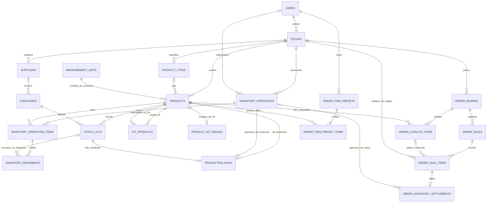

# Entidades e relacionamentos

Este documento descreve o modelo de dados compartilhado pelo **Estoque Pro** e pelo **Acompanhamento de Pedidos** no mesmo projeto Supabase. Ele resume o esquema atual; as migrations SQL continuam sendo a fonte executável para criação e evolução do banco.

## Visão geral

Na parte superior do diagrama estão as entidades de estoque e produção. Na parte inferior estão as entidades de operação de pedidos. Os dois domínios compartilham `stocks`, `products`, `inventory_operations` e os registros de unidade; as tabelas de pedidos não duplicam o cadastro mestre de produtos.

## Estoque, catálogo e compras

| Entidade | Responsabilidade e relações |
|---|---|
| `users` | Conta proprietária. Um usuário pode possuir vários estoques. |
| `stocks` | Raiz de organização dos dados. Pertence a `users`; agrupa tipos, produtos, fornecedores, operações e Kanbans. |
| `product_types` | Tipos/categorias cadastrados dentro de um estoque. `products.type_id` é opcional. |
| `products` | Cadastro mestre de material ou kit (`is_kit`). Guarda identidade, nome, tipo, conteúdo nominal por embalagem (`content_quantity` e `content_unit`), código interno (`sku`, apresentado na interface como código único), margem de referência e preço sugerido. Não é o registro da compra nem do saldo de um lote. |
| `measurement_units` | Catálogo de códigos de unidade, dimensão e fator para unidade-base. Referenciado por conteúdo do produto, itens de receita e produção. |
| `suppliers` | Fornecedor cadastrado dentro do estoque. Uma compra pode referenciar um fornecedor. |
| `purchases` | Cabeçalho da entrada/compra: operação associada, fornecedor opcional, documento e data. Uma compra pode agrupar vários lotes. |
| `stock_lots` | Compra de um produto em um lote específico. Guarda código, unidades compradas, saldo inicial/restante, custo unitário, preço de venda, datas e conteúdo por embalagem daquela compra. `package_content_quantity/unit` permite que lotes do mesmo produto tenham formatos diferentes. |
| `competitor_prices` | Preços de referência de concorrentes associados a um produto. Não altera o custo do lote nem o saldo. |

**Separação importante:** o produto representa o que é comprado/vendido; o lote representa uma aquisição e concentra quantidade disponível, custo e preço praticado. Assim, por exemplo, pacotes de 1 kg e de 300 g podem pertencer ao mesmo produto, com custos diferentes por lote.

## Movimentações e produção

| Entidade | Responsabilidade e relações |
|---|---|
| `inventory_operations` | Cabeçalho imutável de uma operação do estoque, como entrada, baixa ou produção. Pertence a um estoque e pode registrar responsável, referência, motivo, payload e horário. |
| `inventory_operation_items` | Linhas solicitadas/executadas da operação: produto, quantidade e unidade. Pertence a uma operação. |
| `inventory_movements` | Efeito efetivo no estoque por item e lote, com quantidade e custo/preço por unidade-base. Liga uma linha da operação ao lote afetado; é o histórico detalhado de entrada/consumo. |
| `kit_products` | Composição/receita de um produto marcado como kit. `kit_id` é o produto/kit produzido e `product_id` é material ou outro kit consumido; quantidade e unidade definem a proporção. É uma relação muitos-para-muitos autorreferenciada em `products`. |
| `product_kit_images` | Relação opcional de imagem para kit, separada do cadastro mestre. Cada registro aponta a um produto-kit e armazena `image_path`. |
| `production_runs` | Registro do resultado de produzir um kit. Liga kit, operação, lote resultante, quantidade/unidade produzida e custo de entrada; também guarda indicação de componentes faltantes e se o custo é completo ou estimado. |

Uma operação pode ter várias linhas, e cada linha pode resultar em várias movimentações por lote. Isso permite registrar consumo FIFO e entradas/baixas distribuídas por lotes sem perder o vínculo com a operação original.

## Pedidos, Kanbans e catálogo de venda

| Entidade | Responsabilidade e relações |
|---|---|
| `order_boards` | Kanban pertencente a um estoque, como “Geral”, um dia ou uma equipe. Um Kanban possui catálogo e pedidos próprios. |
| `order_catalog_items` | Item publicado no menu de um Kanban: produto mestre, preço de venda naquele catálogo e possível custo manual. Não é um novo produto de estoque. O par Kanban/estoque é validado para evitar vínculos cruzados inconsistentes. |
| `order_sales` | Pedido do Kanban, com número, cliente, observação, totais sugerido/final, valor pago, status e horários. O nome legado da tabela é `order_sales`, mas cada linha representa um pedido. |
| `order_sale_items` | Linhas do pedido. Guarda quantidade, nome/preço capturados e snapshots financeiros calculados ao finalizar: receita, custo, origem/completude do custo e margem. Pode manter `catalog_item_id` opcional para preservar o histórico mesmo se o item do catálogo for removido. |
| `order_inventory_settlements` | Uma liquidação por linha vendida: quantidades solicitada, baixada e pendente, situação, custo efetivo, mensagem de pendência e operação de estoque, quando existir. |
| `order_item_presets` | Preset de seleção e preços pertencente à conta Supabase autenticada. O nome é único dentro da conta; pode ser usado em qualquer estoque/Kanban dessa conta. `stock_id` legado registra o estoque selecionado ao salvar, mas não limita onde o preset pode ser carregado. |
| `order_item_preset_items` | Produtos e preços guardados em cada preset. Os IDs dos produtos e os valores configurados persistem juntos. Pode apontar para produtos de diferentes estoques do mesmo proprietário. |

### Pedidos com produtos de vários estoques

`order_sales.stock_id` identifica o estoque dono do Kanban e do contexto operacional do pedido. Um item importado pode, porém, pertencer a outro estoque da mesma conta. Por isso, `order_sale_items.source_stock_id` e `source_stock_name` registram o estoque de origem do produto. Na conclusão, baixa e custo são associados ao estoque de origem de cada linha. O estoque de origem é um snapshot para auditoria; o nome armazenado não muda se o estoque for renomeado.

### Conclusão e baixa

Concluir pedido atualiza o pedido mesmo se não houver saldo suficiente. A liquidação baixa o disponível até zero e registra eventual diferença como quantidade pendente. Os estados são `settled`, `partial` e `pending`. Custos, preço e margem congelados na linha concluída formam o retrato financeiro histórico; mudanças futuras em catálogo, produto ou lotes não reescrevem esse retrato.

## Leituras derivadas

Views expõem modelos de leitura e não substituem as tabelas responsáveis pelos dados:

| View | Domínio | Conteúdo |
|---|---|---|
| `product_catalog` | Estoque | Catálogo enriquecido com tipo, saldo, custos e informações de conteúdo/lotes. |
| `products_with_types`, `product_margins`, `competitor_analysis` | Estoque | Leituras de produto com tipo, margem e referências de concorrência. |
| `order_board_menu_items` | Pedidos | Itens e preços publicados em cada Kanban. |
| `order_tickets`, `order_ticket_items` | Pedidos | Cabeçalhos e linhas em formato de leitura para a interface. |

## Regras de leitura do modelo

1. Use `products` para identidade do material/kit; consulte `stock_lots` para saldo e preços de compra/venda por lote.
2. Use `purchases` como cabeçalho da entrada e `stock_lots` como detalhes dos produtos recebidos.
3. Use `inventory_operations` como cabeçalho, `inventory_operation_items` como linhas declaradas e `inventory_movements` como efeito efetivo por lote.
4. Use `kit_products` para receita; a existência de uma receita não significa que o kit já esteja produzido. A produção efetiva aparece em `production_runs` e no lote resultante.
5. Use `order_catalog_items` para preço publicado no Kanban; use `order_sale_items` para o que foi efetivamente vendido e seus snapshots.
6. Use `order_inventory_settlements` para verificar cobertura da baixa de estoque, sem inferir saldo a partir apenas do status do pedido.

## Migrations de referência

- Estoque: `sirius-cosmical-stock2/supabase/schema.sql` e migrations `migration_lotes.sql`, `migration_medidas.sql`, `migration_kit_recipes.sql`, `migration_kit_production.sql`, `migration_inventory_extensions.sql`, `migration_lot_package_content.sql` e migrations incrementais posteriores.
- Pedidos: `supabase/orders_monolith.sql` e migrations `migration_order_boards.sql`, `migration_order_multi_stock_catalog.sql`, `migration_order_sale_settlement.sql`, `migration_order_analytics.sql` e correções incrementais posteriores.

Os arquivos acima representam a trilha de evolução, não uma ordem universal de execução para bancos já instalados. Em uma instalação existente, confira o histórico e aplique apenas migrations ainda pendentes. Não execute o `schema.sql` do Estoque sobre uma base com dados.
